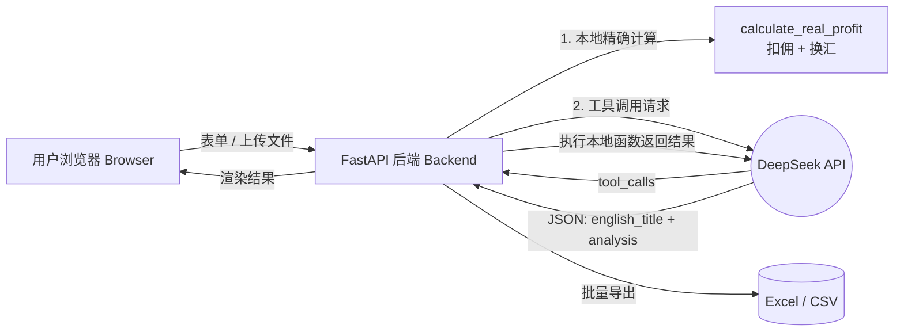

# 跨境电商选品分析工具 · Cross-Border E-Commerce Product Analyzer

> 基于 **FastAPI + DeepSeek Function Calling + JSON 约束输出** 的本地 Web 小工具，支持单条与批量（Excel/CSV）商品分析。
>
> A local web tool built with **FastAPI + DeepSeek Function Calling + Structured JSON Output**, supporting both single-item and batch (Excel/CSV) product analysis.


---

## 📋 目录 · Table of Contents

- [✨ 核心特性 · Features](#-核心特性--features)
- [🏗️ 项目架构 · Architecture](#️-项目架构--architecture)
- [📁 目录结构 · Project Structure](#-目录结构--project-structure)
- [🚀 本地启动 · Quick Start](#-本地启动--quick-start)
- [🧩 使用方式 · Usage](#-使用方式--usage)
- [🔐 安全说明 · Security](#-安全说明--security)
- [📸 效果截图 · Screenshots](#-效果截图--screenshots)
- [🛣️ 路线图 · Roadmap](#️-路线图--roadmap)

---

## ✨ 核心特性 · Features

| 功能 Feature | 说明 Description |
|---|---|
| 🧠 **DeepSeek Function Calling** | 模型自主决定调用本地 `calculate_real_profit` 函数，获取扣佣换汇后的精确利润，避免模型「心算」误差。<br>The model autonomously calls the local `calculate_real_profit` function for accurate profit (commission + FX excluded), avoiding LLM arithmetic hallucination. |
| 📝 **JSON 约束输出** | 翻译标题 + 分析建议通过 `response_format=json_object` 严格输出 JSON，Python 端稳定解析。<br>Title translation & analysis returned as strict JSON via `response_format=json_object`. |
| 🌐 **FastAPI Web 界面** | 零前端构建，内嵌 HTML/CSS/JS，表单输入即时返回英文标题、利润数据与分析建议。<br>No frontend build; inline HTML/CSS/JS form returns English title, profit, and analysis instantly. |
| 📊 **批量 Excel/CSV 处理** | 上传多商品表格，3 路并发调用 AI，结果一键导出为 Excel。<br>Upload a product sheet; process in parallel (3 workers); export results to Excel. |
| 🔒 **本地计算优先** | 利润展示数据始终来自本地 Python 精确计算，AI 仅负责翻译与文本分析。<br>Profit figures always come from local Python; AI only handles translation & text analysis. |

---

## 🏗️ 项目架构 · Architecture



**调用流程 · Flow：**

1. 前端提交商品标题、进价、售价。
2. 后端先用 `calculate_real_profit` 本地算出利润（展示数据源）。
3. 同时请求 DeepSeek，声明 `tools`；模型返回 `tool_calls` → 后端执行本地函数 → 把结果回传模型。
4. 模型基于真实利润输出 `{english_title, analysis}` JSON。
5. 单条返回页面渲染；批量则汇总后导出 Excel。

---

## 📁 目录结构 · Project Structure

```
ai-tools/
├── web_app.py                 # FastAPI 主应用（单条 + 批量 + 模板下载）
├── deepseek_function_call.py  # Function Calling 示例 + 本地利润函数 + tools 定义
├── deepseek_test.py           # 基础对话 / 结构化 JSON 输出示例
├── requirements.txt           # 依赖清单
├── .gitignore                 # Git 忽略规则（含 __pycache__、.env、密钥文件）
├── .env.example               # 环境变量示例
└── README.md                  # 本文件
```

---

## 🚀 本地启动 · Quick Start

### 1. 克隆 & 安装依赖 · Clone & Install

```bash
git clone <your-repo-url>
cd ai-tools
pip install -r requirements.txt
```

### 2. 配置 API Key · Configure API Key

在 [platform.deepseek.com](https://platform.deepseek.com) 创建 API Key，然后任选一种方式：

**推荐：环境变量（不写入代码）**

```powershell
# Windows PowerShell
$env:DEEPSEEK_API_KEY="sk-xxxxxxxxxxxxxxxx"
```

```bash
# macOS / Linux
export DEEPSEEK_API_KEY="sk-xxxxxxxxxxxxxxxx"
```

> ⚠️ 切勿将真实 Key 提交到 Git。`.env.example` 仅为模板，真实 `.env` 已被 `.gitignore` 忽略。

### 3. 启动服务 · Run

```bash
python web_app.py
```

浏览器打开 **http://127.0.0.1:8000**

---

## 🧩 使用方式 · Usage

### 单条分析 · Single Item
在页面表单填入商品中文标题、进价（元）、售价（美元），点击「开始分析」。

### 批量处理 · Batch
1. 点击「下载模板」获取 `template.xlsx`。
2. 按 `标题 / 进价 / 售价` 三列填入商品数据并保存。
3. 在批量卡片上传文件 → 「开始批量处理」。
4. 完成后点击「下载分析结果 Excel」，结果含：英文标题、收入、佣金、净利润、净利润率、AI 建议。

---

## 🔐 安全说明 · Security

- API Key 通过环境变量 `DEEPSEEK_API_KEY` 注入，**不硬编码在源码中**。
- `.gitignore` 已忽略 `.env`、`__pycache__/`、`*.key`、`*token*` 等敏感与运行时文件。
- 利润计算由本地 Python 完成，AI 不参与数值运算，保证结果可复现。

---

## 📸 效果截图 · Screenshots

> 请将实际截图放入 `docs/screenshots/` 目录，并替换下方路径。

### 主页与单条分析 · Homepage & Single Analysis


### 批量处理与 Excel 下载 · Batch & Download


### 下载的结果 Excel · Result Excel


---

## 🛣️ 路线图 · Roadmap

- [ ] 支持自定义汇率与平台佣金比例输入
- [ ] 批量处理进度实时回显（SSE / WebSocket）
- [ ] 历史分析记录本地存储（SQLite）
- [ ] 多模型切换（deepseek-chat / deepseek-reasoner）
- [ ] Docker 一键部署

---

## 📄 许可证 · License

MIT License — 可自由用于个人作品集与学习。
